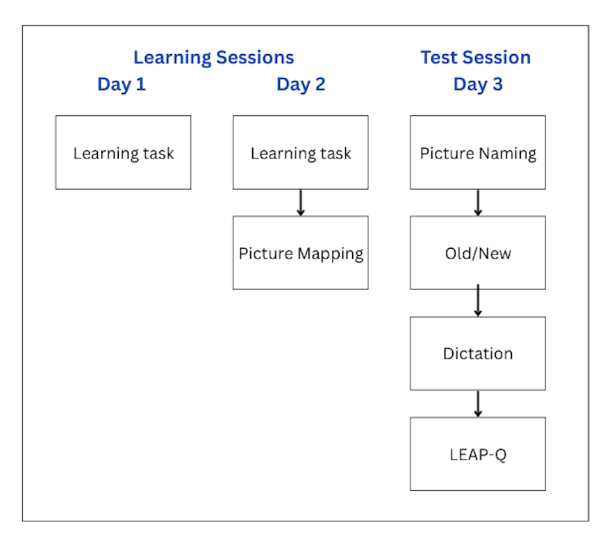

```{r setup, include = FALSE}
Sys.setenv(LANG = "en")

rm(list = ls())
library("papaja")
r_refs("L2Spellreferences.bib")
library(tidyverse)
library(data.table)
library(zoo)
library(plm)
library(car)
library(psychometric) 
library(lme4)
library(Rmisc)
library(lmerTest)
library(formatR)
library(ggplot2)
library(ggthemes)
library(MASS)
library(dplyr)
library(knitr)
library(sjPlot)
library(designr)
library(gdata)
library(broom.mixed)
#library(citr)
library(modelsummary)
library(ggdist)
library(ggpubr)
library(bayesplot)
library(rstan)
library(doBy)
library(magick)
library(cowplot)
library(gridExtra)
library(psychometric)
library(pandoc)
#library(sjPlot)
library(kableExtra)
library(ggeffects)
library(ggExtra)

require(mgcv)
require(itsadug)
require(xtable)
require(ggpubr)
require(ggeffects)

sessionInfo()  
```

```{r analysis-preferences}
set.seed(42)
knitr::opts_chunk$set(cache.extra = knitr::rand_seed)
knitr::opts_chunk$set(echo = F,eval=TRUE, results= "show", fig.keep="all", cache=T, message=F, warning=F, silent = TRUE, refresh = 0)
options(knitr.table.format = "latex")
```

# Introduction

Learners of a second language (L2) encounter new words by hearing them (in the course of a conversation), reading them (in a message or on a sign in a shop window), or both (in the classroom or in a subtitled film). Results from several studies show that orthographic input during learning can lead to less native-like pronunciations in the target language [@hayes2018orthographic; @bassetti2017orthography; @bassetti2015effects; @rafat2016orthography; @rafat2021first; @burki2019orthography; @welby2022spelling], especially in cases in which the learner's native (L1) and second (L2) languages share an alphabet and grapheme-to-phoneme correspondences (GPCs) conflict across languages. For instance, @hayes2018orthographic investigated L1 English productions of German devoiced word-final obstruents [p,t,k], which are represented with graphemes `<`b`>`,`<`d`>`, and `<`g`>`, respectively, in German (e.g., [g\textepsilon lt] is written *Geld* ~ "money"). Influenced by (L1) English mappings of the graphemes to phonetically voiced [b,d,g], participants were more likely to produce voiced obstruents word-finally (e.g., [g\textepsilon ld]) in German pseudowords learned with orthographic input than for words learned without.

  Interfering effects of orthographic input on pronunciation in L2 word learning have been documented along several phonological dimensions, including consonant voicing and manner of articulation, vowel and consonant length, and vowel quality, as well as epenthetic spelling pronunciations (e.g., producing a [b] at the end of *lamb*) [@bassetti2015effects; @bassetti2017orthography; @rafat2021first; @burki2019orthography]. In our own work, we tested the effect of orthographic input on L1 French speakers' productions of English vowels /\textsci / and /\textscripta / (spelled `<`i`>` and `<`o`>`, respectively), which do not feature in Hexagonal French, in newly learned English pseudowords (e.g., *nif* /n\textsci f/, *gosk* /g\textscripta sk/). We found that participant vowel productions were more French-like in terms of vowel quality (i.e., were closer to the French vowels represented by the same graphemes, /i/ for `<`i`>`, and /\textopeno / for `<`o`>`) for words learned with orthographic input than for those learned with only the spoken form [@burki2019orthography; @welby2022spelling].
  
   Other studies report facilitative effects of orthographic input on L2 pronunciation, particularly in cases where orthographic forms draw attention to hard-to-acquire L2 phonemic contrasts [@rafat2015interaction; @steele2005assessing]. For instance, @rafat2015interaction tested naïve English speakers' productions of Spanish word-final fricative rhotics (e.g., *ahumar* [auma\u{r}]). She found that participants who learned the words with orthographic input had higher rates of productions with rhotic consonants (both fricative [\u{r}] and postalveolar approximant [\textturnr]) than participants in the auditory-only learning condition, who were more likely to assimilate [\u{r}] to English /\textesh /. In still other studies, both less and more native-like productions in word learning with orthographic input have been observed for different forms of the same word [@barrios2020second].
  
  This body of work informs us about the impact of orthographic input on learners' productions of novel L2 words and suggests either that information about the spelling of a word is integrated directly into its phonological representation, or that during speaking, stored orthographic information is activated together with phonological information to influence pronunciation. Importantly, these findings do not address how orthographic knowledge could influence productions when a novel word has been experienced solely in its auditory form. There is both behavioral and neural evidence that orthographic mappings are activated in auditory-only speech perception in adults [@chereau2007reading; @taft2008automatic; @ziegler2004visual; @ziegler1998orthography; @perre2008line]. In all of these studies, known L1 words that have only one possible spelling (orthographically consistent words) were recognized faster than words that have multiple possible spellings (orthographically inconsistent words) in unimodal auditory lexical decision. Further, @perre2008line observed a neural response time-locked with sounds that are orthographically inconsistent that was absent for orthographically consistent words, suggesting that it was the activation of multiple orthographic mappings in the former case that resulted in slower lexical decision times.
  
  Given this evidence, researchers have sought to test whether orthographic mappings are activated when listeners encounter *novel* spoken words. In @johnston2004evidence, adult participants learned unfamiliar L1 words and their definitions by hearing and repeating them back to an experimenter, with no exposure to their possible spellings. In a series of visual lexical decision experiments with masked repetition priming with the learned words, as well as with familiar L1 words and untrained nonwords, faster reaction times were observed in identity priming (e.g., coggle-COGGLE) and pseudohomophone priming (koggil-COGGLE) conditions than for a control condition (e.g., banper-COGGLE) for visually-novel spellings of the learned words, but not for untrained nonwords. For familiar words but not for the newly-learned words, reaction times were faster in identity priming than in the pseudohomophone priming conditions. The authors interpreted their findings as evidence that participants had generated broadly-specified orthographic representations of novel words during learning. <!--MD: but just a note that this could simply be because they had heard all words except for the nonwords, and so had no built phonological representation with which to compare written nonword stimuli, see also McKague et al., 2001.--> Further investigations in auditory word learning paradigms with sentence reading [@wegener2023orthographic; @wegener2018children] demonstrate that both literate children and adults show a preference (i.e., faster reading times) for canonical over non-canonical spellings for newly learned L1 words upon first visual presentation. Collectively, these results are consistent with an account in which learners automatically generate expectations for the spellings of novel spoken words upon hearing them for use in the subsequent processing of their written forms.
  
 In the present study, we test the hypothesis that orthographic representations generated in auditory word learning influence learner pronunciations of novel L2 words. In @welby2022spelling, we found that French productions of the English vowel /\textscripta / in words learned with auditory input only were more variable than for words learned with both auditory and orthographic input. We speculated that the larger dispersion of vowels in the vowel space for the words learned without orthographic input could reflect differences in generated orthographic representations across participants or words, as GPCs for French and English low back vowels are not cross-linguistically consistent. For instance, when hearing /bl\textscripta p/, some participants may generate the spelling "blap" (drawing from the GPC of nearby French /a/ with `<`a`>`), while others would generate the spelling "blop" (in line with the typical English spelling convention), and these differences could in turn be reflected in their pronunciations. This is the hypothesis we aim to test here. <!--MD: I know AB said to leave this part out (I think PW originally put it in), but I found it such a clear summary prefacing the current study that I chose to leave it in. Happy to reconsider-->
 
 <!--MD 16.nov: But I left this out, and would like to add to discussion later : In the literature reviewed above, interfering orthographic effects on pronunciation in novel L2 word learning can be explained by L2 learners’ over-reliance on L1 GPCs upon exposure to the orthographic form (e.g., [\textesh t\textscripta \textsci d] for [\textesh t\textscripta \textsci t] ~ *Steid*; @hayes2018orthographic). Even in the absence of orthography, both L1 and L2 grapheme-to-phoneme correspondences (GPCs) could be activated when learners hear novel L2 words; indeed, @marian2021spoken observed evidence for the activation of conflicting L1 and L2 orthographic mappings during auditory perception of novel L2 words that were initially learned with orthography in an eye-tracking task in the visual world paradigm. Which orthographic mappings learners might activate during word learning in the absence of orthographic input could influence their subsequent word productions in cases in which these mappings conflict cross-linguistically, another object of our investigation here.-->

# The present study

Building on evidence that listeners generate orthographic representations for novel words in the absence of orthographic input, we ask whether generated orthographic representations in turn impact their pronunciations. We compare the performance of L1 French speakers on three tasks in an English pseudoword learning paradigm. In the learning phase (Days 1 & 2), participants learned to associate auditorily-presented English pseudowords all featuring the low vowel /\textscripta/ (e.g., /bl\textscripta p/) with images of rare plants, animals, and objects, without any orthographic input. In the test phase (Day 3), participants completed, in the order listed, a Picture Naming task (Task 1), in which they named pseudowords aloud upon seeing their associated images, an Old/New task (Task 2), in which they decided as quickly as possible whether presented orthographic word forms were words they learned (Old) or not (New) (with two target spelling conditions: grapheme `<`o`>` *blop* ~ grapheme `<`a`>` *blap*), and a Dictation task (Task 3), in which they provided their own spelling for each auditorily-presented pseudoword. Note that participants encountered orthographic word forms for the first time in the Old/New task on Day 3, after spoken responses from the Picture Naming task were recorded. See Figure 1 for a schematization of the full experiment design.

```{r, echo=FALSE, out.width="60%", out.height="40%", fig.align="center",fig.cap="Design schema for the different phases of the experiment."}

```

 English /\textscripta/, typically represented with the grapheme `<`o`>` in closed syllables (as in /st\textscripta p/ ~ *stop*), is produced close to but backer than French /a/, written `<`a`>` (as in /baz/ ~ *base*), and to a lesser extent close to yet lower and fronter than French /\textopeno/, written `<`o`>` (as in /p\textopeno m/ ~ *pomme*). Preliminary evidence from previous work (@welbyroles) demonstrates that L1 French learners of English primarily use `<`a`>` and `<`o`>` when asked to spell English pseudowords with /\textscripta/ that they have heard but have never seen in writing. If French participants rely more on their L1 GPCs to map vowels in English pseudowords to graphemes, we predict that they will spell pseudowords with the grapheme `<`a`>` (e.g, *blap*) at a higher rate than with `<`o`>`. If they use their knowledge of English GPCs, we predict more spellings with the grapheme `<`o`>` (e.g., *blop*) than with `<`a`>`, in line with English spelling conventions. Crucially, regardless of the distribution of spelling preferences that will be observed, it is the choice between `<`a`>` and `<`o`>` that will be used to test the hypotheses under consideration here. To test whether L2 learners generate spellings from auditorily-learned pseudowords, we will compare alignment on observed spelling preferences in the Old/New task (Task 2) to later spelling responses in Dictation (Task 3). To test whether L2 learners' spellings are reflected in their pronunciations, we will measure whether vowel formants in Picture Naming responses (Task 1) can be predicted by the vowel letter given in later Dictation  (Task 3) responses. 
 
   Our predictions are as follows: first, in line with the hypothesis in the literature that listeners generate orthographic representations of auditorily-learned pseudowords in the absence of orthographic input, we expect a higher rate of Old responses "yes, I learned this word" and faster reaction times in the Old/New task for orthographic word forms that match participants' own later spellings in the Dictation task (i.e., for "blap" responses in Dictation, we expect a higher rate of Old responses and faster reaction times for matching orthographic word form *blap* over mismatching *blop* in the Old/New task). Such a result would indicate participants formed a preference of one orthographic word form over another by or upon their first encounter of pseudoword spellings in the Old/New task, suggesting that an orthographic representation was generated prior to exposure to the written form. Second, if generated orthographic representations influence pronunciations of novel pseudowords even in the absence of orthographic input, then we expect formant values of vowels in Picture Naming responses to align more closely with the vowels corresponding to the vowel letter provided in participants' later Dictation spellings (i.e., vowels for items later spelled with `<`a`>` would be fronter and lower, and vowels for items spelled with `<`o`>` would be higher and backer). Such a result would be in line with an involvement of orthographic knowledge in the formation of vowel production targets in L2 pseudowords before exposure to the orthographic form.

# Methods
## Participants

```{r echo = F, results = 'hide', eval = T, cache=T}
# read table and configure 
#ld <- read_delim("/Users/mdailey/Downloads/UNIL/FNS_Audrey_WP3/Experiment2_Arina/Data/Data_collection_Preprocessing/SoSciSurvey/soscisurvey_data_all_included_oct25.csv")

ld <- read_delim("soscisurvey_data_all_included_oct25.csv")

# fix columns
#cols <- ld[1,]
#ld <- ld[-1,]

# both header rows have bad names, but first header row has usable names in r
# refer to excel version for highly descriptive second row header names 
# above six lines only relevant for original doc soscisurvey_data_all_included.csv

names(ld)[116] <- "uniqueID"

# only include included subjects
ld=ld[-which(ld$uniqueID %in% c("72141","92586","24480","95411","102423","87920")),]

# drop rows with only NA
ld=ld[rowSums(is.na(ld)) != ncol(ld),]

# get mean and SD of age of participants : column name I103s
ld$I103s = as.numeric(ld$I103s)

mean_age <- mean(ld$I103s)
median_age <- median(ld$I103s)
sd_age <- sd(ld$I103s)


# starting AoA : COLUMN NAME EN02_01
ld$EN02_01 = as.numeric(ld$EN02_01)

mean_AoA <- mean(ld$EN02_01)
median_AoA <- median(ld$EN02_01)
sd_AoA <- sd(ld$EN02_01)

min_AoA <- min(ld$EN02_01)
max_AoA <- max(ld$EN02_01)

# Self-rated proficiency: oral comprehension EN04_02 and production EN04_01
# oral comp
ld$EN04_02 = as.numeric(ld$EN04_02)

mean_OC = mean(ld$EN04_02)
sd_OC = sd(ld$EN04_02)

# oral production
ld$EN04_01 = as.numeric(ld$EN04_01)

mean_OP = mean(ld$EN04_01)
sd_OP = sd(ld$EN04_01)

# Current exposure to English : QS03_04
# note : manually checked that all input values were about exposure to English specifically (QS03_03)

# get only numbers
ld$QS03_04 = str_replace_all(ld$QS03_04, "%", "")

# now convert
ld$QS03_04 = as.numeric(ld$QS03_04)

min_exp = min(ld$QS03_04)
max_exp <- max(ld$QS03_04)

mean_exp = mean(ld$QS03_04)
sd_exp = sd(ld$QS03_04)

```

 Participants were 35 native French-speaking adults fluent in English (self-reported), recruited via Prolific (www.prolific.com). All were French, residing in France, and reported no history of vision or hearing impairments or learning disorders. Informed consent was obtained via an electronic consent form, and participants were compensated €20 for approximately one and half hours of experiment time. The data of seven participants were excluded from analyses for the following reasons: four reported learning English before the age of six, one submitted low quality audio recordings, one did not follow task instructions, and one participant's data were lost due to a server malfunction. 

Responses from the remaining 28 participants were included in analyses. These participants were aged 18 to 35 years old (median=`r printnum(median_age, digits=0)`,SD=`r printnum(sd_age)`), and started learning English at on average `r printnum(mean_AoA)` years of age (range=6-13 years, SD=`r printnum(sd_AoA)`) in school. Participants rated their English oral comprehension and production skills at `r printnum(mean_OC)` (SD=`r printnum(sd_OC)`) and `r printnum(mean_OP)` (SD=`r printnum(sd_OP)`) out of 10, respectively, and estimates of their current exposure to English ranged anywhere from 9-70% (mean=`r printnum(mean_exp)`, SD=`r printnum(sd_exp)`).


## Materials

 Stimuli were 14 phonotactically plausible English pseudowords, all monosyllabic with C(C)VC(C) syllable structure and featuring the low back vowel /\textscripta/ (e.g., /bl\textscripta p/; see Table 1 for full list). Pseudoword consonant segments were restricted to those that appear in both French and English phonological inventories, and there were no minimal pairs in the list. The /\textscripta/ vowel was chosen for pseudowords because it exhibits conflicting grapheme-to-phoneme correspondences (GPCs) between French and English. In English, /\textscripta/ is typically represented with an `<`o`>` grapheme (e.g., *stop* /st\textscripta p/). In Hexagonal French, there is no /\textscripta/ vowel, therefore, French listeners are expected to perceptually assimilate /\textscripta/ either to French /a/, which is typically represented with an `<`a`>` grapheme in French (e.g., *base* /baz/), or to French /\textopeno/, which is typically represented with grapheme `<`o`>` in French (e.g., *pomme* /p\textopeno m/). 
 
  Pseudowords were recorded by a male native speaker of North American English from Florida^1^. The speaker read the pseudowords aloud from a list at a self-selected speaking rate, reading through the entire list sequentially four times. Materials were recorded in a quiet room using an AKG C520 L head-worn microphone and a Zoom H4nSP Handy recorder at a sampling rate of 44.1 kHz. All four tokens of each pseudoword were played in the learning phase, and the first token of each item was played during the Dictation task in the test session. 
  
   Pseudowords were paired with images of rare plants, animals, and objects for the learning sessions and the Picture Naming task in the test session. Rare plants, animals, and objects were chosen to ensure participants would not already have learned their real English names. All stimuli including recordings and images can be found at the open repository for the project \href{https://github.com/autanonsubmit2143/Ortho-in-auditory-L2-learning}{here.}

For each pseudoword, a set of four spellings was generated for use in the Old/New task (Table 1). The two target spellings featured `<`o`>` and `<`a`>` graphemes (e.g., *blop* and *blap*). In addition, two distractor spellings were created, featuring one- and two-phoneme transformations of the original pseudowords. The one-phoneme transformation spelling always featured the graphemes `<`i`>` or `<`e`>` (e.g., *blep*), corresponding to front high or mid-high vowels in both French and English, and the two-phoneme transformation spelling featured the other front high or mid-high vowel grapheme and a different consonant coda grapheme (e.g., *blit*). Graphemes corresponding to high and mid-high vowels were used in the distractor spelling sets because they represent vowels that are far in the vowel space from the target low vowels. As in the original pseudoword list, only consonant graphemes present in both English and French were used in the distractor spelling lists.

**Table 1.** Pseudoword target and distractor spelling sets 

Phonological form | Target `<`o`>` | Target `<`a`>` | Distractor 1 | Distractor 2
------------------|----------|----------|--------------|-------------  
  /bl\textscripta p/         |   blop   |   blap   |     blep     |    blit
  /b\textscripta lf/         |   bolf   |   balf   |     bilf     |    belk
  /d\textscripta p/          |   dop    |   dap    |     dep      |    dif
  /gl\textscripta g/         |   glog   |   glag   |     glig     |    glet
  /g\textscripta sk/         | gosk     | gask     | gesk         | gisp
  /l\textscripta sp/         |   losp   |   lasp   |     lesp     |    lisk
  /m\textscripta z/          |   moz    |   maz    |     mez      |    mif
  /n\textscripta f/          |   nof    |   naf    |     nif      |    nep
  /sk\textscripta k/         |  skock   |   skack  |     skick    |    skep
  /sl\textscripta z/         |   sloz   |   slaz   |     sliz     |    slev
  /t\textscripta v/          |   tov    |   tav    |     tiv      |    teb
  /v\textscripta d/          |   vod    |   vad    |     ved      |    vig
  /z\textscripta t/          |   zot    |   zat    |     zet      |    zib
  /z\textscripta ks/         |   zox    |   zax    |     zix      |    zet

 1 The speaker comes from a dialect region where the most common low back vowel system includes a singular (merged) /\textscripta/ vowel. An F1 X F2 plot of the speaker's normalized vowel midpoints for recorded stimulus tokens can be found in Appendix 1. 
 
```{r echo = F, results = 'hide', eval = T, cache=T}
# Prepare talker vowel midpoint data for visualization
# read in data

d <- read.csv("model-talker-learning-tokens-formants-2.txt",sep="\t",header=T)

summary(d)

# split first column to get item name
d <- na.omit(d)

d <- d %>% separate_wider_delim(X.name.., "_",names=c(NA,"vowel_letter","langue","genre","init","item","rep"))

# rename relevant cols
colnames(d)[7] <- "F1_Hz"
colnames(d)[8] <- "F2_Hz"
colnames(d)[9] <- "F1_Bark"
colnames(d)[10] <- "F2_Bark"

#rename irrelevant cols
colnames(d)[11] <- "vowel_dur"
colnames(d)[12] <- "f0_mean"

# get rid of i item
d_o=d[(d$vowel_letter == "o" | d$vowel_letter == "a"),]

d_o5 = d_o

# Visualization code in appendix_Arina.Rmd

 
```


## Design and procedure

  The experiment was run online with PCIbex Farm, an open-source experiment-building software and hosting platform [@PCIbex]. Participants completed two learning sessions and one test session over the course of three days. No fewer than one day and no more than two days passed between sessions. At the end of the final session, participants completed an online version of the LEAP-Q language background questionnaire [@marian2007language], administered through the SoSciSurvey platform [@SoSciSurvey] at www.soscisurvey.de.
  
  At the beginning of each session, participants were instructed to sit in a quiet environment with their computer and a pair of headphones equipped with a microphone. They were instructed to first adjust the sound level to a comfortable volume on the basis of a short audio file of speech-shaped noise that they could replay as many times as needed. Then, they completed a psychophysical task to verify proper headphone use [@woods2017headphone]. Finally, they signed a digitalized consent form for their participation. The overall design of the experiment is summarized in Figure 1.
  
*Day 1: Learning Session 1*

  Participants were told that they would be learning new English words for a language learning app under development by an American company, and that they would be tested on how well they had learned the words. Each trial proceeded as follows: an image appeared in the center of the screen, followed 1000 milliseconds later by the onset of the audio recording of the corresponding pseudoword. The image remained on the screen until 3000 milliseconds after audio recording offset, at which point the next pseudoword image was presented to start the next trial. All four recordings of the 14 pseudowords were presented five times each in 20 consecutive blocks, for a total of 20 presentations of each pseudoword-image pair. The order of presentation of items in each block was randomized. Pseudowords were presented without any orthographic input, and participants were instructed not to take notes during the session. The Day 1 learning session lasted approximately twenty minutes. 
  
  
*Day 2: Learning Session 2*

  The procedure for the Day 2 learning session was identical to that of Day 1, with one addition: at the end of the session, participants completed a Picture Mapping task to verify pseudoword acquisition. Participants heard each pseudoword and were asked to select its corresponding image in a two-alternative forced-choice (2AFC) task. Participants were given trial-by-trial feedback immediately after their response in the form of a brief message displayed on the screen (*Correct!* or *Incorrect!*). Pseudowords were presented four times in four consecutive blocks. Trial order within blocks was randomized, and image position in each trial was shuffled. Response accuracy on the Picture Mapping task was analyzed in order to exclude participants who did not engage in the learning tasks. The entire session lasted approximately 25 minutes. As in the previous session, no orthographic input for the pseudowords was provided. 
 
*Day 3: Test Session*

  Participants completed three tasks in the test session, in the order presented below. The session lasted approximately twenty minutes.  
  
 *Task 1: Picture Naming.* Participants were presented with the images of the pseudowords learned on Days 1 and 2. Images were presented one by one on the screen for 5000 ms. A fixation cross was displayed in the center of the screen for 500 ms before each new image. Participants were asked to name the images aloud as quickly and as accurately as possible, and an audio recording of their responses was made. The 14 pseudowords were presented three times in three separate blocks. Presentation order was randomized within block. No orthographic word forms were presented with the images; thus, participants had no exposure to orthographic input at any point prior to or while completing the task. Vowel formant values were analyzed with later Dictation responses to determine whether pseudoword pronunciation varied as a function of participants' later proposed spellings (e.g., /bl\textscripta p/ produced lower and fronter when spelled "blap" than when spelled "blop").

*Task 2: Old/New.* Participants were presented with orthographic word forms on the screen, one after another, and were instructed to decide whether each word they saw was a pseudoword they had learned (Old) or not (New), as quickly and as accurately as possible via keyboard response. Orthographic word forms from the four spelling conditions (two target and two distractor conditions in Table 1; e.g., *blop* ~ *blap* ~ *blep* ~ *blit*) were presented to each participant in four blocks, such that one spelling per item was presented in each block; thus, all participants responded to all target and distractor spellings for all items. Block order (x4) and button response order (x2) were counterbalanced across eight groups of participants. No auditory forms of the pseudowords were presented during the task. Responses in this task were analyzed with later Dictation responses to determine whether participants had a higher rate of Old responses as well as shorter response latencies for the Old/New spellings that matched their own proposed spellings in Dictation (e.g., more Old responses and shorter response latencies to *blop* > *blap* when later spelled "blop" in the Dictation task).

*Task 3: Dictation.* Finally, participants heard each pseudoword once and were asked to type what they heard. Vowel letters from responses were analyzed in tandem with responses on the Picture naming and Old/New tasks, as described above. No images of the pseudowords were presented in this task.


# Results

  Analyses were carried out with the lme4 package [@R-lme4] in the R environment [@R-base]. The data and scripts used for all analyses can be found \href{https://github.com/autanonsubmit2143/Ortho-in-auditory-L2-learning}{here.} Analyses consisted of (generalized) mixed-effects regressions conducted on responses and response latencies. In each model, fixed effects were contrast-coded using scaled sum contrast (i.e., with the values -0.5 and 0.5 assigned to the levels of the fixed effects) such that the intercept represented the grand mean and slopes represented differences between factor levels. Unless otherwise specified, the random effects structure was the maximal one supported by the design. When the model with the maximal structure did not converge, we removed the random slope that accounted for the least variance. Significance was established by means of a likelihood ratio test with nested models with the same random structure.
  

*Picture Mapping*

```{r echo = F, results = 'hide', eval = T, cache=T}

pm <- read_csv("Day2_PictMap_respdata_all28sujs_July.csv")

# overall Mean accuracy rate + SD
mean_pm_acc <- mean(pm$Correct)
sd_pm_acc <- sd(pm$Correct)

# Calculate by-participant response accuracy in final block
pm4 <- subset(pm, Label=="matching4")

# overall Mean accuracy rate + SD in last block 
mean_pm_acc_lastblock <- mean(pm4$Correct)
mean_sd_acc_lastblock <- sd(pm4$Correct)

# tally of correct responses
pm$Correct = as.factor(pm$Correct)
levels(pm$Correct)

pm_tally = pm %>% group_by(Correct) %>% tally()
pm_tally

# incorrect response variable manually
incorrect_pm_resp = 47

# same with total response variable
total_pm_resp = 1568


```


  Responses on the Day 2 Picture Mapping task were analyzed to ensure that participants had learned the pseudoword-image associations and were ready for the Day 3 Test session. Response accuracy was at ceiling: together the 28 participants gave only `r printnum(incorrect_pm_resp, digits=0)` incorrect responses out of `r printnum(total_pm_resp, digits=0)` total responses (97% accuracy rate). Participants thus had little difficulty associating images with the pseudoword labels, and none were excluded on the basis of poor performance. Responses in this task were not analyzed further.
  
*Dictation*

  
```{r, echo=F, results="hide", fig.show='hide'}
# Read data 

fs <- read_csv("results_FormantsSpelling_withAccNorm_33participants_Sep-15.csv")

fsd <- subset(fs, str_detect(fs$name, "-2"))

# Responses on dictation by vowel letter and participant 
dpv <- data_frame(ID = fsd$ID,item=fsd$item, vowel_letter = fsd$vowel_letter, vowel_letter_3way= fsd$vowel_letter_3way, vowel_letter_4way=fsd$vowel_letter_4way,English=fsd$English)

# Dictation response by item visualization
div <- data_frame(item = dpv$item, vowel_letter = dpv$vowel_letter, vowel_letter_3way= dpv$vowel_letter_3way, vowel_letter_4way=dpv$vowel_letter_4way,ID=dpv$ID,English=dpv$English)

div_incl = div[-which(div$ID %in% c("72141","92586","24480","95411","102423","87920")),]

div_count = div_incl %>% group_by(item, vowel_letter_4way) %>% tally()

div_count_allvowel_item = div_incl %>% group_by(item,vowel_letter) %>% tally()

div_count_allvowel = div_incl %>% group_by(vowel_letter) %>% tally()

o_num <- div_count_allvowel[4,2] 
a_num <- div_count_allvowel[1,2] 
u_num <- div_count_allvowel[7,2] 

# percentages
dictresp_all_num <- sum(div_count_allvowel$n)

o_percent <- (o_num/dictresp_all_num)*100
a_percent <- (a_num/dictresp_all_num)*100
u_percent <- (u_num/dictresp_all_num)*100

o_a_percent <- ((o_num+a_num)/dictresp_all_num)*100

# change lowercase to capital letters for vis
div_count_a <- subset(div_count, vowel_letter_4way=="a")
div_count_a$VOWEL_LETTER = "A"

div_count_o <- subset(div_count,vowel_letter_4way=="o")
div_count_o$VOWEL_LETTER = "O"

div_count_u <- subset(div_count,vowel_letter_4way=="u")
div_count_u$VOWEL_LETTER = "U"

div_count_ao <- merge(div_count_a,div_count_o,all.x=T,all.y=T)
div_count_aou <- merge(div_count_ao,div_count_u, all.x=T,all.y=T)

# Visualization for Appendix: Vowel letter response by Item 
div_bar <- ggplot(div_count_aou, aes(x=item, y=n,fill=VOWEL_LETTER))+
  geom_bar(stat="identity",position="stack",width=0.9) +
  theme_minimal() +
  #ggtitle("Dictation vowel letter responses by item")+
  theme(axis.text.x=element_text(angle=45,vjust=1,hjust=1),legend.position="bottom",axis.text=element_text(size=11))+
  labs(fill="Vowel Letter",x="Item")+
  scale_fill_brewer(palette="Set2")
div_bar
```


  Given that participant responses in the Dictation task are analyzed with the data in the Old/New and Picture Naming tasks, we start by describing the responses in this task. The bar chart in Appendix 2 displays the rate of spellings by chosen vowel letter for each item. The two most common spellings chosen for pseudowords (all with English vowel /\textscripta /) were those with vowel letters `<`a`>` (`r printnum(a_percent, digits=0)`% of responses) and `<`o`>` (`r printnum(o_percent, digits=0)`% of responses). Spellings with `<`u`>` were observed to a lesser extent (`r printnum(u_percent, digits=0)`% of responses), and spellings with all other graphemes or digraphs (e.g., `<`oa`>`) had fewer than three responses each.
  
*Old/New* 

```{r echo = F, results = 'hide', eval = T, cache=T}
# Read in data
#c_data <- read_csv('/Users/mdailey/Downloads/UNIL/FNS_Audrey_WP3/Experiment2_Arina/DataAnalysis/results_Categorization_34participants_Sep-11.csv')

c_data <- read_csv('results_Categorization_34participants_Sep-11.csv')

# Exclude the 6 excluded subjects : 95411, 24480, 102423, 87920, 92586, 72141
c_data <- c_data[-which(c_data$uniqueID %in% c("72141","92586","24480","95411","102423","87920")),]

#Create column RT
c_data$RT <- c_data$selection_time - c_data$canvas_time

# Create column "accuracy": if for words presented in distractor conditions (blep/blick) responded 'Old' (yes I learned this word) - 0, otherwise - 1
c_data$accuracy <- ifelse((c_data$ButtonGroup == "FJ" 
                         & c_data$condition %in% c('condOtherVowel', 'condOther') 
                        & (c_data$selection == 'F' | is.na(c_data$selection))), 0,
                   ifelse((c_data$ButtonGroup == "JF" 
                         & c_data$condition %in% c('condOtherVowel', 'condOther') 
                        & (c_data$selection == 'J' | is.na(c_data$selection))), 0, 1))

# Table - Participant X Accuracy, Distractor conditions only 
d_data <- c_data[which(c_data$condition %in% c('condOtherVowel','condOther')),]

on_acc <- aggregate(data=d_data,accuracy~uniqueID,mean)
distract_taux_new <- mean(on_acc$accuracy)*100

distract_taux_new_sd <- sd(on_acc$accuracy)

# calculate same for Condition A 
aon_data <- c_data[which(c_data$condition %in% c('condA')),]

# new column that just calculates 1 - Old and 0 - New
aon_data$oldnew_num <- ifelse((aon_data$ButtonGroup == "FJ" 
                        & (aon_data$selection == 'F' | is.na(aon_data$selection))), 1,
                   ifelse((aon_data$ButtonGroup == "JF" 
                        & (aon_data$selection == 'J' | is.na(aon_data$selection))), 1, 0))

# rate old response mean & sd
aon_acc <- aggregate(data=aon_data,oldnew_num~uniqueID,mean)
aon_taux_old <- mean(aon_acc$oldnew_num)*100

aon_taux_old_sd <- sd(aon_acc$oldnew_num)

# calculate same for Condition O
oon_data <- c_data[which(c_data$condition %in% c('condO')),]

# new column that just calculates 1 - Old and 0 - New
oon_data$oldnew_num <- ifelse((oon_data$ButtonGroup == "FJ" 
                        & (oon_data$selection == 'F' | is.na(oon_data$selection))), 1,
                   ifelse((oon_data$ButtonGroup == "JF" 
                        & (oon_data$selection == 'J' | is.na(oon_data$selection))), 1, 0))

# rate old response mean & sd
oon_acc <- aggregate(data=oon_data,oldnew_num~uniqueID,mean)
oon_taux_old <- mean(oon_acc$oldnew_num)*100

oon_taux_old_sd <- sd(oon_acc$oldnew_num)

```

 As an additional check of data quality, we first verified that all participants responded "New" (no, I did not learn this word) to the majority of distractor spellings. We also examined the rate of "Old" (yes, I learned this word) responses to target spellings. For this analysis, all responses were considered. In distractor trials, the rate of "New" responses was on average `r printnum(distract_taux_new, digits=0)`% (sd=`r printnum(distract_taux_new_sd)`), confirming that participants performed the task as expected. 
  In target trials, the rate of "Old" responses for spellings with letter `<`a`>` was `r printnum(aon_taux_old, digits=0)`% on average (sd=`r printnum(aon_taux_old_sd)`), and for spellings with letter `<`o`>` `r printnum(oon_taux_old, digits=0)`% on average (sd=`r printnum(oon_taux_old_sd)`).
 
 *Old/New X Dictation* 
  
```{r echo = F, results = 'hide', eval = T, cache=T}
# Some data in c_data$spelling is missing for some participants for condA :
subset_sa <- subset(c_data, condition %in% c('condA'))
sum(is.na(subset_sa$spelling))

subset_so <- subset(c_data, condition %in% c('condO'))
sum(is.na(subset_so$spelling)) 

# Since one spelling was given per participant, create dataframe of participant, item, and spelling from condO data
# Then populate missing cells in spelling column in c_data for condA only
subset_sp <- subset_so[,c('uniqueID','spelling','item')]

subset_sp$uniqueID <- as.character(subset_sp$uniqueID)
subset_sp$spelling <- as.character(subset_sp$spelling)
subset_sp$item <- as.character(subset_sp$item)

c_data$uniqueID <- as.character(c_data$uniqueID)
c_data$spelling <- as.character(c_data$spelling)
c_data$item <- as.character(c_data$item)

for(i in 1:nrow(c_data)){
  for(j in 1:nrow(subset_sp)){
    if(c_data$condition[i] == 'condA' & 
       c_data$uniqueID[i] == subset_sp$uniqueID[j] &
       c_data$item[i] == subset_sp$item[j] &
       is.na(c_data$spelling[i])){
      c_data$spelling[i] = subset_sp$spelling[j]
    }
  }
}

# check
subset_sa <- subset(c_data, condition %in% c('condA'))
sum(is.na(subset_sa$spelling)) 

# Subset data : only items in O & A conditions in Old/New and that received at least two correct responses in Picture Naming:
c_data <- subset(c_data, condition %in% c('condO', 'condA'))
c_data_ao <- c_data

# at least two correct responses in Picture Naming
c_data <- subset(c_data, NumCorrect > 1)

# Percentage of correct responses
pourc_ond_analyze <- (nrow(c_data)/nrow(c_data_ao))*100
pourc_ond_analyze

# Create Match column (character)
c_data$match <- ifelse(((c_data$condition == 'condA' & c_data$spelling == 'a') | 
                                 (c_data$condition == 'condO' & c_data$spelling == 'o')), 
                                      'Match', 'Mismatch')

#Create a vector, that has value 1 if the selection means 'yes, i learned this word' and 0 otherwise (DV) :
c_data$learned <- ifelse(
                          (c_data$ButtonGroup == "FJ"  
                             & c_data$selection == 'F' ), '1', 
                          ifelse(
                                  (c_data$ButtonGroup == "JF"
                                      & c_data$selection == 'J'), '1','0'
                                 )
                         )

#and a vector, that has value 1 if the spelling is Match and 0 otherwise (predictor - numeric):
c_data$match <- ifelse(c_data$match == 'Match', 1, 0)


c_data$learned <- as.numeric(c_data$learned)

c_data$Match <- ifelse(c_data$match == '1', 'MATCH', 'MISMATCH')


```
 
   Statistical analyses were then conducted on responses to items in target trials in the Old/New task as a function of responses on Dictation. Responses were restricted to those items that participants named correctly at least twice in Picture Naming (`r printnum(pourc_ond_analyze)`% of responses). The goal of these analyses was to test whether participants generated expectations for how the novel pseudowords they learned should be spelled, despite not having received any orthographic input during learning. Under this hypothesis, we expect participants to exhibit a higher proportion of Old responses and faster response latencies in the Old/New task for tokens which matched their later proposed spellings of a given pseudoword in Dictation.
  
  To measure this, a Match variable was created to link responses on the two tasks: i.e., for each participant and item, an Old response for target *blop* and *blop* spelling in Dictation was labelled Match, whereas an Old response for target *blop* and *blap* spelling was labelled Mismatch. (Recall that words were never presented auditorily in the Old/New task; only their written forms were presented.)

```{r echo = F, results = 'hide', eval = T, cache=T}
#Change the categorical variables and random effects into factors, tidy up data, scaled sum contrasts(effects coding):
c_data$ProlificID <-as.factor(c_data$ProlificID)
c_data$uniqueID <- as.factor(c_data$uniqueID)
c_data$item <-as.factor(c_data$item)
c_data$match <-as.factor(c_data$match)
c_data$learned <-as.factor(c_data$learned) 
c_data$ButtonGroup <- as.factor(c_data$ButtonGroup)

c_data <- c_data[!is.na(c_data$learned),]

contrasts(c_data$match) <- c(+0.5, -0.5)

contrasts(c_data$match)

contrasts(c_data$ButtonGroup) <- c(+0.5, -0.5)

contrasts(c_data$ButtonGroup)

# Model
m0 <-lm(learned~match+ButtonGroup,  data=c_data)
c_data$contr.match<-model.matrix(m0)[,2]

m <- glmer(learned~contr.match+ButtonGroup+(1+contr.match||uniqueID)+(1+contr.match|item),family=binomial(), data=c_data)
summary(m)

#m <- glmer(learned~match+ButtonGroup+(1|uniqueID)+(1+match|item),family=binomial(), data=c_data)
#summary(m)

null_m <- glmer(learned~ButtonGroup+(1+contr.match||uniqueID)+(1+contr.match|item), family=binomial(),c_data)
null_m


#null_m <- glmer(learned~ButtonGroup+(1|uniqueID)+(1+match|item), family=binomial(),c_data)
#summary(null_m)

anova_m_null_m <- anova(m,null_m,test="Chisq")
anova_m_null_m

# model numbers
slope_m<-summary(m)$coefficients[2,1]
slope_m

SE_m <-summary(m)$coefficients[2,2]
SE_m

z_m <- summary(m)$coefficients[2,3]
z_m

chisq_m <- anova_m_null_m$Chisq[2]
chisq_m 

# table for appendix
m_table <- tidy(m)

labels_table <- c("Intercept","Match","Button Group")

m_table <- m_table %>%
  filter(effect == "fixed") %>%
  #select(-c(effect, group)) %>%
  mutate(p.value = round(p.value, digits = 3)) %>%
  mutate(p.value = ifelse(p.value < .001, "<.001", p.value))

m_table_select <- m_table %>%
  dplyr::select(term, estimate, std.error, p.value)

m_table_select <- m_table_select %>%
  mutate(across(
    c(estimate, std.error),
    ~ ifelse(abs(.) < 0.01, formatC(., format = "e", digits = 2), formatC(., format = "f", digits = 2))
  ))

m_table_select$term <- plyr::mapvalues(m_table_select$term, m_table_select$term, labels_table)


```
  For the first analysis, a generalized mixed-effects model with a logistic link was conducted with response types (Old=1, New=0) as the dependent variable, Match and Button group (i.e., whether the participant had to respond yes and no with the left and right hands, respectively or conversely) as predictors, random intercepts for participant and item, and a random by-item slope for Match. Button Group was included to control for potential effects of button position. Effect coding was used for both predictors.
  
  Results revealed an effect of Match in the expected direction ($\beta$=`r printnum(slope_m)`, SE=`r printnum(SE_m)`, z=`r printnum(z_m)`, $\chi^2(1)$=`r printnum(chisq_m)`, p<0.001), such that there was a higher proportion of Old responses in Match than Mismatch conditions.
  
```{r echo = F, results = 'hide', eval = T, cache=T}
# Analysis 2 - RT ~ Match 
library(dplyr)
#plot(density(c_data$RT))

# Discard outliers
c_data_no_RT_Outliers <- c_data[c_data$RT<3001,]
c_data_no_RT_Outliers<-c_data_no_RT_Outliers[!is.na(c_data_no_RT_Outliers$match),]

# calculate percent discarded
c_data_RT_discard <- ((nrow(c_data)-nrow(c_data_no_RT_Outliers))/nrow(c_data))*100
c_data_RT_discard

c_data_no_RT_Outliers$match <- as.factor(c_data_no_RT_Outliers$match)
levels(c_data_no_RT_Outliers$match)
c_data_no_RT_Outliers<-droplevels(c_data_no_RT_Outliers)

# Recode factor levels
levels(c_data_no_RT_Outliers$match)<-c("Mismatch","Match")

nrow(c_data_no_RT_Outliers)


# Model 
library(lmerTest)
m0b <-lm(learned~match+ButtonGroup,  data=c_data_no_RT_Outliers)
c_data_no_RT_Outliers$contr.match<-model.matrix(m0b)[,2]
m2 <- lmer(RT~contr.match+ButtonGroup+(1+contr.match||uniqueID)+(1+contr.match||item), c_data_no_RT_Outliers)
summary(m2)

## singular fit because by item slope = 0

mb2 <- lmer(RT~contr.match+ButtonGroup+(1+contr.match||uniqueID)+(1|item), c_data_no_RT_Outliers)
summary(mb2)

#m2 <- lmer(RT~match+ButtonGroup+(1+match|uniqueID)+(1+match|item), c_data_no_RT_Outliers)
#summary(m2)

# qqPlot(residuals(m2))

null_mb2 <- lmer(RT~ButtonGroup+(1+contr.match||uniqueID)+(1|item), c_data_no_RT_Outliers)
summary(null_mb2)

anova_mb2_null_mb2 <- anova(mb2,null_mb2, test="Chisq")
anova_mb2_null_mb2


#null_m2 <- lmer(-RT~ButtonGroup+(1+match|uniqueID)+(1+match|item), c_data_no_RT_Outliers)
#anova_m2_null_m2 <- anova(m2,null_m2, test="Chisq")
#anova_m2_null_m2

# Model numbers 
slope_m2<-summary(mb2)$coefficients[2,1]
slope_m2

SE_m2 <-summary(mb2)$coefficients[2,2]
SE_m2

t_m2 <- summary(mb2)$coefficients[2,4]
t_m2

chisq_m2 <- anova_mb2_null_mb2$Chisq[2]
chisq_m2 

# table for appendix m2
m2_table <- tidy(mb2)

labels_table_2 <- c("Intercept","Match","Button Group")

m2_table <- m2_table %>%
  filter(effect == "fixed") %>%
  #select(-c(effect, group)) %>%
  mutate(p.value = round(p.value, digits = 3)) %>%
  mutate(p.value = ifelse(p.value < .001, "<.001", p.value))

m2_table_select <- m2_table %>%
  dplyr::select(term, estimate, std.error, p.value)

m2_table_select <- m2_table_select %>%
  mutate(across(
    c(estimate, std.error),
    ~ ifelse(abs(.) < 0.01, formatC(., format = "e", digits = 2), formatC(., format = "f", digits = 2))
  ))

m2_table_select$term <- plyr::mapvalues(m2_table_select$term, m2_table_select$term, labels_table_2)


```  
  
  For the second analysis, visual inspection of the distribution of reaction times (RTs) led to the removal of the data points above 3000 milliseconds (`r printnum(c_data_RT_discard, digits=0)`% of data points). Latencies below 3000 milliseconds were then submitted to a linear mixed-effects regression with the same predictors as the previous model on responses, Match and Button Group, and with random intercepts for participant and item and random by-participant and by-item slopes for Match. Results revealed a main effect of Match such that matching responses across tasks led to shorter latencies ($\beta$ =`r printnum(slope_m2)`, SE=`r printnum(SE_m2)`, t=`r printnum(t_m2)`, $\chi^2(1)$=`r printnum(chisq_m2)`, p<0.001). Full model outputs can be found in Appendix 3.
  
  The results from these analyses demonstrate that participants show a preference for and process faster those orthographic word forms in the Old/New task that match their later proposed spellings in the Dictation task. 

*Picture Naming*

```{r echo = F, results = 'hide', eval = T, cache=T}
# Load formant & spelling data
#f_data <- read_csv('/Users/mdailey/Downloads/UNIL/FNS_Audrey_WP3/Experiment2_Arina/DataAnalysis/results_FormantsSpelling_withAccNorm_33participants_Sep-15.csv')

f_data <- read_csv('results_FormantsSpelling_withAccNorm_33participants_Sep-15.csv')

# exclude excluded subjects
f_data <- f_data[-which(f_data$ID %in% c("72141","92586","24480","95411","102423","87920")),]

f_data_all_incl <- f_data

picnam_acc_suj <- aggregate(data=f_data,correct~ID,mean)

picnam_item_acc <- mean(f_data$correct)*100 # this is accuracy rate by item! if item named correctly at least once. 

picnam_item_acc_sd <- sd(picnam_acc_suj$correct)
picnam_item_acc_sd

picnam_token_acc <- mean(f_data$Label_num2)*100 # token accuracy makes more sense since we keep these ones
picnam_token_acc

picnam_token_acc_suj <- aggregate(data=f_data,Label_num2~ID,mean)
picnam_token_acc_suj

picnam_token_acc_sd <- sd(picnam_token_acc_suj$Label_num2)
picnam_token_acc_sd

```

Responses in Picture Naming were coded as correct if they were produced with all expected consonant phonemes in the correct order, a vowel in the same region of the vowel space as the target vowel (e.g., [bl\textscripta p], [bl\textopeno p], [blap] for *blop*), and no additional phones. Responses were coded incorrect otherwise (e.g., [blip] or [bl\textscripta t] for *blop*). If a response included multiple repetitions of a pseudoword in a single recording, it was marked correct if it contained at least one correct utterance of the relevant pseudoword. Overall accuracy in Picture Naming was `r printnum(picnam_token_acc, digits=0)`% (sd=`r printnum(picnam_token_acc_sd)`). Only correct responses were considered in the following analyses.
 
 
 *Picture Naming X Dictation*

```{r echo = F, results = 'hide', eval = T, cache=T}
# store all (even incorrect) Picture Naming responses 
f_data_all_incl <- f_data

# Subset : Only items that participants named correctly AND spelled with a or o
f_data <- subset(f_data, vowel_letter %in% c('a', 'o') & label %in% c('ok', 'C', 'B'))

# overall discard rate (correct AND spelled a or o)
f_discard <- (nrow(f_data_all_incl)-nrow(f_data))/nrow(f_data_all_incl)

f_discard_taux <- f_discard*100
f_discard_taux 

f_keep_taux <- (1-f_discard)*100
f_keep_taux # so additional 7% of items not analyzed because not spelled a or o

n_resp <- nrow(f_data)
n_resp

# Prep data for analysis
f_data$ProlificID <-as.factor(f_data$ProlificID)
f_data$ProlificID <-as.factor(f_data$ID)
f_data$item <-as.factor(f_data$item)
f_data$repetition <-as.factor(f_data$repetition)
f_data$vowel_letter <- as.factor(f_data$vowel_letter)
f_data$label <- as.factor(f_data$label)

f_data <- f_data[!is.na(f_data$F1_Bladon),]
f_data$F1_Bladon <-as.numeric(f_data$F1_Bladon)
f_data <- f_data[!is.na(f_data$F2_Bladon),]
f_data$F2_Bladon <-as.numeric(f_data$F2_Bladon)

# Center the continuous variable
f_data$F1_Bladon <- scale(f_data$F1_Bladon, center = TRUE, scale = TRUE)
f_data$F2_Bladon <- scale(f_data$F2_Bladon, center = TRUE, scale = TRUE)

# contrast code 
contrasts(f_data$vowel_letter) <- c(+0.5, -0.5)

contrasts(f_data$vowel_letter)

# Does vowel letter predict formant values F1 and F2 ?
# F1_Bladon ~ Vowel Letter model 
mF1_Bl <- lmer(F1_Bladon ~1+vowel_letter+(1+vowel_letter|ProlificID)+(1+vowel_letter|item), f_data)
summary(mF1_Bl)

null_mF1_Bl <- lmer(F1_Bladon~1+(1+vowel_letter|ProlificID)+(1+vowel_letter|item), f_data)
anova_mF1_null_mF1_Bl <- anova(null_mF1_Bl,mF1_Bl)

# the estimates of F1
slope_mF1_Bl<-summary(mF1_Bl)$coefficients[2,1]
slope_mF1_Bl

SE_mF1_Bl <-summary(mF1_Bl)$coefficients[2,2]
SE_mF1_Bl

t_mF1_Bl <- summary(mF1_Bl)$coefficients[2,4]
t_mF1_Bl

chisq_mF1_Bl <- anova_mF1_null_mF1_Bl$Chisq[2]
chisq_mF1_Bl 

# F2 ~ Vowel Letter model 
mF2_Bl <- lmer(F2_Bladon ~1+vowel_letter+(1+vowel_letter|ProlificID)+(1+vowel_letter|item), f_data)
summary(mF2_Bl)

null_mF2_Bl <- lmer(F2_Bladon ~1+(1+vowel_letter|ProlificID)+(1+vowel_letter|item), f_data)
anova_mF2_null_mF2_Bl <- anova(null_mF2_Bl,mF2_Bl)

# estimates etc F2 model
slope_mF2_Bl<-summary(mF2_Bl)$coefficients[2,1]
slope_mF2_Bl

SE_mF2_Bl <-summary(mF2_Bl)$coefficients[2,2]
SE_mF2_Bl

t_mF2_Bl <- summary(mF2_Bl)$coefficients[2,4]
t_mF2_Bl

chisq_mF2_Bl <- anova_mF2_null_mF2_Bl$Chisq[2]
chisq_mF2_Bl 

## table for F1 - for appendix 
f1_table <- tidy(mF1_Bl)

labels_table_3 <- c("Intercept","Vowel Letter")

f1_table <- f1_table %>%
  filter(effect == "fixed") %>%
  #select(-c(effect, group)) %>%
  mutate(p.value = round(p.value, digits = 3)) %>%
  mutate(p.value = ifelse(p.value < .001, "<.001", p.value))

f1_table_select <- f1_table %>%
  dplyr::select(term, estimate, std.error, p.value)

f1_table_select <- f1_table_select %>%
  mutate(across(
    c(estimate, std.error),
    ~ ifelse(abs(.) < 0.01, formatC(., format = "e", digits = 2), formatC(., format = "f", digits = 2))
  ))

f1_table_select$term <- plyr::mapvalues(f1_table_select$term, f1_table_select$term, labels_table_3)


## table for F2 - for appendix
f2_table <- tidy(mF2_Bl)

labels_table_4 <- c("Intercept","Vowel Letter")

f2_table <- f2_table %>%
  filter(effect == "fixed") %>%
  #select(-c(effect, group)) %>%
  mutate(p.value = round(p.value, digits = 3)) %>%
  mutate(p.value = ifelse(p.value < .001, "<.001", p.value))

f2_table_select <- f2_table %>%
  dplyr::select(term, estimate, std.error, p.value)

f2_table_select <- f2_table_select %>%
  mutate(across(
    c(estimate, std.error),
    ~ ifelse(abs(.) < 0.01, formatC(., format = "e", digits = 2), formatC(., format = "f", digits = 2))
  ))

f2_table_select$term <- plyr::mapvalues(f2_table_select$term, f2_table_select$term, labels_table_4)


## Oct 31 - Nouvel Analyse 3 - Rajouter l'effet de Talker F1 et Talker F2 (Bladon, means)

tf <- read_csv("analyse_2_Dictee_talkerF1F2.csv")

# read Talker F1 and F2 into participant formant + spelling data file
# Values are Bladon normed means of all (four) tokens, for each item
# .c are columns with centered values 

f_data$Talk_F1_Bladon_mean = NA
f_data$Talk_F2_Bladon_mean = NA
f_data$Talk_F1_Bladon_mean.c = NA
f_data$Talk_F2_Bladon_mean.c = NA

for(i in 1:nrow(f_data)){
  for(j in 1:nrow(tf)){
    if(f_data$item[i] == tf$item[j]){
      f_data$Talk_F1_Bladon_mean[i] = tf$Talk_F1_Bladon_mean[j]
      f_data$Talk_F2_Bladon_mean[i] = tf$Talk_F2_Bladon_mean[j]
      f_data$Talk_F1_Bladon_mean.c[i] = tf$Talk_F1_Bladon_mean.c[j]
      f_data$Talk_F2_Bladon_mean.c[i] = tf$Talk_F2_Bladon_mean.c[j]
    }
  }
}

# Models 
# Does vowel letter and Talker F1 and F2 predict formant values F1 and F2 ?

# F1_Bladon ~ Vowel Letter + Talker F1 model 
mF1_tF1 <- lmer(F1_Bladon ~1+vowel_letter+Talk_F1_Bladon_mean+(1+vowel_letter+Talk_F1_Bladon_mean|ProlificID)+(1+vowel_letter+Talk_F1_Bladon_mean|item), f_data)
summary(mF1_tF1) # failed to converge 


# try with centered predictors 
mF1_tF1.c <- lmer(F1_Bladon ~1+vowel_letter+Talk_F1_Bladon_mean.c+(1+vowel_letter+Talk_F1_Bladon_mean.c|ProlificID)+(1+vowel_letter+Talk_F1_Bladon_mean.c|item), f_data)
summary(mF1_tF1.c) # converged, boundary is singular 
# two strong main effects

# Audrey, do you still recommend removing correlations when boundary is singular for better fit? no

# VIF to check for multicollinearity
# Extract fixed effects data
fixeff_model <- lm(F1_Bladon~1+vowel_letter + Talk_F1_Bladon_mean.c, data = f_data)
vif(fixeff_model) # low collinearity, don't know how to do mixed model though
vif(mF1_tF1.c) # same results

# no vowel model 
mF1_tF1.c.noV <- lmer(F1_Bladon~Talk_F1_Bladon_mean.c+(1+vowel_letter+Talk_F1_Bladon_mean.c|ProlificID)+(1+vowel_letter+Talk_F1_Bladon_mean.c|item), f_data) # did not converge
summary(mF1_tF1.c.noV)
anova_mF1_tF1.c_noV <- anova(mF1_tF1.c.noV,mF1_tF1.c)

# no Talk_F1 model
mF1_tF1.c.noT <- lmer(F1_Bladon~vowel_letter+(1+vowel_letter+Talk_F1_Bladon_mean.c|ProlificID)+(1+vowel_letter+Talk_F1_Bladon_mean.c|item), f_data) # converged
summary(mF1_tF1.c.noT)
anova_mF1_tF1.c_noT <- anova(mF1_tF1.c.noT,mF1_tF1.c)

# interaction
mF1_tF1.c.int <- lmer(F1_Bladon ~vowel_letter*Talk_F1_Bladon_mean.c+(1+vowel_letter+Talk_F1_Bladon_mean.c|ProlificID)+(1+vowel_letter+Talk_F1_Bladon_mean.c|item), f_data)
summary(mF1_tF1.c.int) # converged, boundary is singular 
# only main effect of vowel letter
# no theoretical reason to use model with interaction, so keep model with no interaction


# the estimates of the effect of vowel letter 
slope_mF1_tF1.c.noV <-summary(mF1_tF1.c)$coefficients[2,1]
slope_mF1_tF1.c.noV

SE_mF1_tF1.c.noV <-summary(mF1_tF1.c)$coefficients[2,2]
SE_mF1_tF1.c.noV

t_mF1_tF1.c.noV <- summary(mF1_tF1.c)$coefficients[2,4]
t_mF1_tF1.c.noV

chisq_mF1_tF1.c.noV <- anova_mF1_tF1.c_noV$Chisq[2]
chisq_mF1_tF1.c.noV 


# the estimates of the effect of Talker F1 
slope_mF1_tF1.c <-summary(mF1_tF1.c)$coefficients[3,1]
slope_mF1_tF1.c

SE_mF1_tF1.c <-summary(mF1_tF1.c)$coefficients[3,2]
SE_mF1_tF1.c

t_mF1_tF1.c <- summary(mF1_tF1.c)$coefficients[3,4]
t_mF1_tF1.c

chisq_mF1_tF1.c <- anova_mF1_tF1.c_noT$Chisq[2]
chisq_mF1_tF1.c 


# F2 model
# F2 ~ Vowel Letter model 
mF2_tF2 <- lmer(F2_Bladon ~1+vowel_letter+Talk_F2_Bladon_mean+(1+vowel_letter+Talk_F2_Bladon_mean|ProlificID)+(1+vowel_letter+Talk_F2_Bladon_mean|item), f_data)
summary(mF2_tF2) # failed to converge 

# centered predictors 
mF2_tF2.c <- lmer(F2_Bladon ~1+vowel_letter+Talk_F2_Bladon_mean.c+(1+vowel_letter+Talk_F2_Bladon_mean.c|ProlificID)+(1+vowel_letter+Talk_F2_Bladon_mean.c|item), f_data)
summary(mF2_tF2.c) # converged, boundary is singular
# effect of vowel letter, no effect of mean talker F2 
# weird to have such a high t-value for non significance

# should do VIF on this too maybe 
vif(mF2_tF2.c) # ratio is 1.14, not much inflation of variance compared to model without

# no vowel letter
mF2_tF2.c.noV <- lmer(F2_Bladon~1+Talk_F2_Bladon_mean.c+(1+vowel_letter+Talk_F2_Bladon_mean.c|ProlificID)+(1+vowel_letter+Talk_F2_Bladon_mean.c|item), f_data) 
summary(mF2_tF2.c.noV)
anova_mF2_tF2.c_noV <- anova(mF2_tF2.c.noV,mF2_tF2.c)

# no talker F2 
mF2_tF2.c.noT <- lmer(F2_Bladon~1+vowel_letter+(1+vowel_letter+Talk_F2_Bladon_mean.c|ProlificID)+(1+vowel_letter+Talk_F2_Bladon_mean.c|item), f_data) # converged
summary(mF2_tF2.c.noT)
anova_mF2_tF2.c_noT <- anova(mF2_tF2.c.noT,mF2_tF2.c)
anova_mF2_tF2.c_noT

# interaction
# centered predictors 
mF2_tF2.c.int <- lmer(F2_Bladon ~1+vowel_letter*Talk_F2_Bladon_mean.c+(1+vowel_letter+Talk_F2_Bladon_mean.c|ProlificID)+(1+vowel_letter+Talk_F2_Bladon_mean.c|item), f_data)
summary(mF2_tF2.c.int) # converged, boundary is singular
# same 
# as in other, keep original model because no theoretical reason for interaction 

# the estimates of the effect of vowel letter, F2
slope_mF2_tF2.c.noV <-summary(mF2_tF2.c)$coefficients[2,1]
slope_mF2_tF2.c.noV

SE_mF2_tF2.c.noV <-summary(mF2_tF2.c)$coefficients[2,2]
SE_mF2_tF2.c.noV

t_mF2_tF2.c.noV <- summary(mF2_tF2.c)$coefficients[2,4]
t_mF2_tF2.c.noV

chisq_mF2_tF2.c.noV <- anova_mF2_tF2.c_noV$Chisq[2]
chisq_mF2_tF2.c.noV

# model estimates for the no effect of Talker F2
slope_mF2_tF2.c.noT <-summary(mF2_tF2.c)$coefficients[3,1]
slope_mF2_tF2.c.noT

SE_mF2_tF2.c.noT <-summary(mF2_tF2.c)$coefficients[3,2]
SE_mF2_tF2.c.noT

t_mF2_tF2.c.noT <- summary(mF2_tF2.c)$coefficients[3,4]
t_mF2_tF2.c.noT

chisq_mF2_tF2.c.noT <- anova_mF2_tF2.c_noT$Chisq[2]
chisq_mF2_tF2.c.noT


## table for F1 - for appendix 
f1_tF1_table <- tidy(mF1_tF1.c)

labels_table_5 <- c("Intercept","Vowel Letter","Talker F1")

f1_tF1_table <- f1_tF1_table %>%
  filter(effect == "fixed") %>%
  #select(-c(effect, group)) %>%
  mutate(p.value = round(p.value, digits = 3)) %>%
  mutate(p.value = ifelse(p.value < .001, "<.001", p.value))

f1_tF1_table_select <- f1_tF1_table %>%
  dplyr::select(term, estimate, std.error, p.value)

f1_tF1_table_select <- f1_tF1_table_select %>%
  mutate(across(
    c(estimate, std.error),
    ~ ifelse(abs(.) < 0.01, formatC(., format = "e", digits = 2), formatC(., format = "f", digits = 2))
  ))

f1_tF1_table_select$term <- plyr::mapvalues(f1_tF1_table_select$term, f1_tF1_table_select$term, labels_table_5)


## table for F2 - for appendix 
f2_tF2_table <- tidy(mF2_tF2.c)

labels_table_6 <- c("Intercept","Vowel Letter","Talker F2")

f2_tF2_table <- f2_tF2_table %>%
  filter(effect == "fixed") %>%
  #select(-c(effect, group)) %>%
  mutate(p.value = round(p.value, digits = 3)) %>%
  mutate(p.value = ifelse(p.value < .001, "<.001", p.value))

f2_tF2_table_select <- f2_tF2_table %>%
  dplyr::select(term, estimate, std.error, p.value)

f2_tF2_table_select <- f2_tF2_table_select %>%
  mutate(across(
    c(estimate, std.error),
    ~ ifelse(abs(.) < 0.01, formatC(., format = "e", digits = 2), formatC(., format = "f", digits = 2))
  ))

f2_tF2_table_select$term <- plyr::mapvalues(f2_tF2_table_select$term, f2_tF2_table_select$term, labels_table_6)


```

  The aim of the present analysis was to test the hypothesis that participant pronunciations of auditorily-learned L2 pseudowords would be influenced by generated orthographic representations of those pseudowords, reflected by their later proposed spellings in Dictation. Recall that in French, GPCs for graphemes `<`o`>` and `<`a`>` correspond to vowels /\textopeno/ and /a/, respectively. If French participant pronunciations of English /\textscripta/-vowel pseudowords are influenced by generated orthographic representations, we would expect pseudowords later spelled with `<`o`>` to be produced higher and backer (with lower F1 and F2) than pseudowords later spelled with `<`a`>` (thus, pulled towards corresponding /\textopeno/ and /a/ phonemes, respectively).  
 
 For analyses, vowels in each correct response were segmented in Praat [@praat] with a semi-automated alignment script. Then, first and second formant values (F1 and F2) were extracted from vowel midpoints. Finally, formant values were normalized following the @bladon1984towards procedure described and evaluated in @flynn2011comparing. Normalization formulas can be found in Table 2.   

### Table 2 
Formulas for speaker normalization by sex, from @bladon1984towards.      

Measure | Formula   
--------|-------- 
Normalization at vowel midpoint for women | *F~i~^N^* = 26.81($\frac{F_i}{1960+F_i}$) - 1.53  
Normalization at vowel midpoint for men |  *F~i~^N^* = 26.81($\frac{F_i}{1960+F_i}$) - 0.53
  Each normalized formant value was associated with the vowel letter of the participant's response for the relevant pseudoword in Dictation. Only formant values of pseudowords for which participants gave an `<`o`>` or `<`a`>` spelling in Dictation were analyzed, for a total of `r printnum(n_resp)` data points for analysis. These data are mapped in the F1 by F2 vowel plot with corresponding Dictation vowel letter responses shown in Figure 2. Upon visual inspection, it seems that there is a separation of vowel midpoints in the F1xF2 space such that pseudowords later spelled with `<`o`>` are produced higher and backer than pseudowords later spelled with `<`a`>`, as expected.  
  Statistical analyses confirmed this observation. Two separate generalized linear mixed regressions were conducted on normalized F1 and F2 values, respectively, with Vowel letter response in Dictation as a predictor. Results revealed a main effect of Vowel letter in the expected directions in both models; that is, lower F1 and lower F2 values were observed for pseudowords later spelled with `<`o`>` than with `<`a`>` (F1: $\beta$=`r printnum(slope_mF1_Bl)`, SE=`r printnum(SE_mF1_Bl)`, t=`r printnum(t_mF1_Bl)`, $\chi^2(1)$=`r printnum(chisq_mF1_Bl)`, p<0.01; F2: $\beta$=`r printnum(slope_mF2_Bl)`, SE=`r printnum(SE_mF2_Bl)`, t=`r printnum(t_mF2_Bl)`, $\chi^2(1)$=`r printnum(chisq_mF2_Bl)`, p<0.001). Full results from both models can be found in Appendix 4.
 
  
```{r echo = F, results = 'hide', eval = T, cache=F}
library(ggplot2)

# Vowel plot 
# reload data (because centered, etc.)
# Load formant & spelling data ready for visualization, from Dictee_graphs_adapted_Arina-participants.R


d_o4 <- read_csv('d_o5_data4vis_F1xF2BladonplotXDictee.csv')


summary(d_o4)
# Bladon-normalized plot
p_o4_norm <- ggplot(d_o4, aes(x=F2_Bladon, y=F1_Bladon, label=vowel_typed2, color=vowel_typed2)) + 
  #theme_bw(base_size=13)+
  geom_text(size=2.6)+scale_x_reverse()+scale_y_reverse()+xlab("Normalized F2")+ylab("Normalized F1")
  #ggtitle("26 Participants' Vowel Midpoints in Picture Naming X Dictation Vowel Letter Response")

p_o4_norm2 <- p_o4_norm + scale_x_reverse(
  limits = c(15,6.5),
  breaks = c(15,14,13,12,11,10,9,8,7,6),
  labels = c("15", "","13","","11","","9","","7","")
) + scale_y_reverse(
  limits = c(9,3),
  breaks = c(9,8,7,6,5,4,3),
  labels = c("9", "", "7", "", "5", "", "3")
)+theme_bw(base_size=11) + scale_color_brewer(palette="Set2")+ 
  labs(color="Vowel Letter - Dictation Response")+
  theme(legend.position = 'bottom',legend.title=element_text(size=12),axis.title=element_text(size=12),) + 
  stat_ellipse(aes())
p_o4_norm2

```
**Figure 2.** F1xF2 plot of vowel midpoints of Picture Naming responses. Data points are labeled with the vowel letter chosen in Dictation response. Ellipses represent 95% confidence intervals.   

  To investigate a possible additional influence of the speaker's vowel productions in the stimulus materials on participant vowel productions, a second set of generalized linear mixed regressions were run on participant normalized F1 and F2 values in a posthoc analysis. Fixed factors included Vowel Letter, for both models, and Speaker normalized F1 and F2 for the participant F1 and F2 models respectively. Continuous predictors were centered to help with convergence. The regression on participant F1 values yielded main effects of Vowel Letter ($\beta$=`r printnum(slope_mF1_tF1.c.noV)`, SE=`r printnum(SE_mF1_tF1.c.noV)`, t=`r printnum(t_mF1_tF1.c.noV)`, $\chi^2(1)$=`r printnum(chisq_mF1_tF1.c.noV)`, p<0.01) and Speaker F1 ($\beta$=`r printnum(slope_mF1_tF1.c)`, SE=`r printnum(SE_mF1_tF1.c)`, t=`r printnum(t_mF1_tF1.c)`, $\chi^2(1)$=`r printnum(chisq_mF1_tF1.c)`, p<0.001) in the expected directions: <!--MD added--> F1 values were lower (corresponding to a higher vowel) when speaker F1 values were lower and when participants used grapheme `<`o`>` (vs. grapheme `<`a`>`) in Dictation responses. The regression on participant F2 values yielded a main effect of Vowel Letter only in the expected direction, i.e., participant F2 values were lower (corresponding to a backer vowel) when participants used grapheme `<`o`>` (vs. grapheme `<`a`>`) in Dictation responses ($\beta$=`r printnum(slope_mF2_tF2.c.noV)`, SE=`r printnum(SE_mF2_tF2.c.noV)`, t=`r printnum(t_mF2_tF2.c.noV)`, $\chi^2(1)$=`r printnum(chisq_mF2_tF2.c.noV)`, p<0.001). No main effect of Speaker F2 was observed (p = 0.1). Therefore, effects of Vowel Letter response in Dictation on participant vowel formant values are observed even when potential variation in responses from variation in the speaker's productions are taken into account. Full model results can be found in Appendix 5.
  

# Discussion

 Previous research demonstrates that when learning new words in a second language, seeing their spellings impacts how learners pronounce them [@hayes2018orthographic; @bassetti2015effects; @rafat2016orthography; @rafat2021first; @welby2022spelling]. In the present study, we examined the effect of orthographic knowledge on the productions of new L2 words that are learned without any orthographic input. Results from previous studies suggest that both native and non-native listeners generate spellings for new spoken words they encounter [@johnston2004evidence; @wegener2023orthographic; @wegener2018children]. In the present study, we test this hypothesis and additionally ask whether these auto-generated spellings in turn impact learners' pronunciations.

 French participants learned to associate spoken English pseudowords that featured the low back vowel /\textscripta / (e.g., *blop* /bl\textscripta p/) with images of rare plants, animals and objects in two learning sessions over the course of two days, without any orthographic input. At test (Day 3), they named pseudowords aloud upon image presentation (Picture Naming), before ever having encountered their spellings. They were subsequently presented with possible spellings of the learned pseudowords with graphemes `<`o`>` and `<`a`>` (e.g., *blop* ~ *blap*) intermixed with spellings for similar pseudowords they had not learned (e.g., *blep* ~ *blit*) and categorized each spelling as either a learned (Old) or a non-learned word (New). Finally, they provided their own spellings for each pseudoword upon presentation of its spoken form (Dictation). We measured whether the spellings the participants provided in the Dictation task corresponded with their vowel productions in the Picture Naming task as well as with their spelling choices and response times in the Old/New task.
 
Even though French participants completed the Dictation task after being presented with possible pseudoword spellings in the Old/New task, they exhibited a higher rate of Old responses ("yes, I learned this word") and faster reaction times in the Old/New task to English pseudoword spellings in which the vowel grapheme presented on the screen matched the vowel grapheme in their own later spellings in Dictation (either with `<`a`>` or `<`o`>`, e.g., *blap* or *blop*). That participants already exhibited a preference for spellings upon first presentation in the Old/New task that matched their later spellings in Dictation is as predicted under the hypothesis that participants had formed orthographic representations of the words prior to encountering their written forms. Additionally, participant vowel formants extracted from responses in the Picture Naming task aligned with French vowel production targets corresponding to their own later spellings of the pseudowords in Dictation (i.e., vowels later spelled with `<`a`>` were produced closer to /a/, vowels later spelled with `<`o`>` were produced closer to /\textopeno /), above and beyond the influence of the model speaker's productions found on participant formant values. This second finding is congruent with the hypothesis that the participants' orthographic representations generated during learning in turn influenced their vowel productions, prior to any exposure to the written form. <!--not personally convinced, I just think they correlate and it is perception based. Can someone else who is convinced argue it any better by explaining why? If not can just leave as is-MD. AB: I agree that all we can say is that the result is congruent with this hypothesis, but this is what we say so I think it's fine--> As such, this result provides a potential explanation for the larger dispersion of formant values for English pseudowords with /\textscripta / learned without orthographic input in our previous work with French learners of English [@welby2022spelling], i.e., that participants in that experiment generated both `<`o`>` and `<`a`>` spellings that they used as production targets for words learned without orthography, compared to only `<`o`>` for words learned with orthography. Taken together, these results add to and extend previous work <!--MD changed, softened, expanded and clarified the wording here. AB I like it.--> examining orthographic effects on the comprehension and processing of newly-encountered spoken words [@johnston2004evidence; @wegener2023orthographic] to suggest an influence of orthographic knowledge on their pronunciations, even in the absence of orthographic input.

French participants chose both `<`a`>` and `<`o`>` spellings for the novel words in the Old/New task but exhibited an overall preference for `<`a`>` over `<`o`>` (e.g., *blap* > *blop*), both in the Old/New task and in their own spellings in the Dictation task. This result implies that they relied more often on L1 French grapheme-to-phoneme correspondences (GPCs) in constructing orthographic representations for the L2 English pseudowords. (The conventional GPC for English /\textscripta / is with letter `<`o`>` as in *stock* or *pot*, not `<`a`>`, which corresponds more frequently with English /\ae{}/ as in *stack* or *pat*.) Moreover, participant vowel productions aligned with their Dictation responses based on L1 French GPCs, resulting in a large portion of vowel productions in the range of French /a/ (and outside the L1 range for English /\textscripta /), particularly along the F2 dimension. The question arises whether the prominent influence of L1 orthographic and phonological information observed on learners' spelling preferences and pronunciations of L2 pseudowords is the result of the participants' immersion in their L1 language environment and therefore lesser reported current exposure to English (mean=24%), both as listeners and as readers. In this case, vowel productions that approach French vowel formant values could be the result of exposure to French-accented English being the most common variety of English heard by our participants. Further research comparing immersed and non-immersed L2 users is needed to test the role of current L2 exposure on the role of L1 orthographic knowledge on the development of L2 phonological representations in word learning.

Nonetheless, French participants provided an `<`o`>` spelling in Dictation responses in a non-negligible number of cases. <!--which suggests that our participants did not solely rely on the L1 grapheme-to-phoneme correspondences to generate a spelling for the novel words. -- MD not necessarily, I don't think that in every case they chose o that means they did not rely on L1 GPCs. They perceived some vowels as backer, then generated the o grapheme for backer words or maybe some other random ones, and then produced them backer (or maybe they just generate nothing and rely only on the auditory phonological percept..). AB: I agree and changed to have both explanations here given that the second one is directly related to our research question, you put it later in the paragrpah but I brought it back here--> It is possible that for these words, participants relied on English GPCs (i.e., that vowel /\textscripta / is typically linked to grapheme `<`o`>` in English) to generate their responses. Alternatively, the choice of the spelling could have been influenced by variation in the speaker's productions, i.e., they chose grapheme `<`o`>` for those productions that were closer to French vowel /\textopeno /. In an exploratory analysis, we examined whether speaker vowel formant values correlated with participants' spelling responses in Dictation. We found this to be the case: as speaker F1 and F2 decreased, the probability of an `<`o`>` response in Dictation increased. \footnote{We also ran an exploratory analysis on the effect of Speaker F1 and F2 on Participant F1 and F2 values, reported in the Results section above. Participant F1 values were predicted both by Speaker F1 and Vowel Letter response in Dictation, and Participant F2 values were predicted by Vowel Letter response in Dictation, but no effect of Speaker F2 was observed. This analysis suggests that pronunciation is impacted both by what participants heard and their own spellings. On why no effect of speaker F2 is observed can be seen when comparing normalized formant value ranges of the speaker with the participants (Appendix 1 and Figure 2): while speaker and participant F1 values fall within similar ranges (approximately 4-7 Bladon normalized), the range of participant F2 values extends notably higher (fronter) than that of the speaker's F2 values (12+ vs. 10 Bladon normalized, for participants and speaker, respectively), aligning more closely with the range expected for French /a/. That is, though L2 participants were sensitive to speaker vowel height in choosing production targets for pseudoword vowels, they produced fronter formant values than those they had heard from the speaker, suggesting a greater influence of L1 orthographic and/or phonological information along this dimension in their vowel productions.}  It is possible that analogies with existing English words (e.g., *wasp* for *lasp*) played a role as well. An interesting question for future research would be to determine how stable participant spellings are during novel word learning, as this could inform us as to whether part of the variation we see in Dictation responses in fact reflects an instability in L2 learners' developing orthographic and/or phonological representations. 

So far, we have interpreted our results under the assumption that our L2 participants generated an orthographic representation for the novel words they encountered in the auditory modality, in line with empirical findings in L1 novel word learning research [@johnston2004evidence; @wegener2023orthographic; @wegener2018children]. Under this assumption, the fact that the spellings chosen by our participants correlated with their pronunciations prior to spelling exposure suggests that generated orthographic representations influenced their phonological representations of the novel words, or were activated in parallel during the naming of novel words. Notably, our findings can be explained without reference to an automatically generated orthographic representation: it could be argued that our French participants formed and stored auditory phonological representations only, which corresponded to or were more similar to French /a/ or French /\textopeno / depending on the word (i.e., English /\textscripta / was assimilated to either of the two French low vowels and a unimodal auditory phonological representation of each word developed accordingly). Under this scenario, in the Old/New task, lower acceptance of and slower reaction times to mismatching spellings from their Dictation responses would be a direct result of a mismatching or slower comparison of the phonological categories activated by the orthographic form on the screen (whether L1 or L2) with their developed auditory phonological representation of each pseudoword. Orthographic representations could have then first been developed during the Old/New task or even at the Dictation task, further, participant spelling responses in Dictation (to a single heard instance of each pseudoword during the task) could have been guided by their auditory phonological representation of the vowel, as previously discussed. In the Picture Naming task, production targets for pseudoword vowels could then be assimilated auditory phonological percepts instead of orthographic representations. Considered in isolation, the data of the current experiment do not allow us to distinguish between the two interpretations. Given the evidence for the generation of orthographic word forms during native word learning discussed herein and for the activation of orthographic information during native speech perception seen in masked priming experiments with lexical decision [@halle2000b; @chereau2007reading; @ziegler2004visual], we maintain that the activation of orthographic information in an L2 word learning context is a plausible explanation for our results.<!-- AB: I took your arguments but made the text shorter and removed some of the repetitions MD ok --> The results of the present study encourage further research comparing L2 learners' production and orthographic representation of newly-encountered L2 words with their perception in order to start to disentangle the two accounts. 

  To conclude, previous work shows that orthographic input in L2 word learning can render productions more L1-like, as learners recruit L1 phonemes from provided L2 spellings that they use as production targets [@welby2022spelling; @hayes2018orthographic]. Here, we show that in the absence of orthographic input, L2 learners more often rely on L1 grapheme-to-phoneme correspondences (GPCs) to choose their own spellings for novel L2 pseudowords; further, their chosen spellings align with their pronunciations of pseudoword vowels, elicited before they had encountered or produced any spellings of their own. Taken together, these results suggest that L1 orthographic knowledge plays a role in the development of phonological and orthographic representations in L2 word learning even when no orthography is present in training. In addition to uncovering new questions about the role of orthographic information in L2 phonological word learning, these results carry practical implications for L2 pronunciation pedagogy: if L1 orthographic information interferes with L2 pronunciation learning even in the absence of orthographic input, then targeted interventions to not only draw attention to (as in @hayes2018orthographic) but train to overcome the influence of conflicting GPCs between native and target languages should be developed to improve learning outcomes. 


# Acknowledgements
  
  This research was funded by the Swiss National Science Foundation - grant number 229932. We further thank the University of Potsdam (Germany), where the data was collected, and acknowledge the support of the Deutsche Forschungsgemeinschaft (DFG - German Research Foundation) and the Agence Nationale de la Recherche (ANR
- French National Research Agency).

\newpage

# References

::: {#refs custom-style="Bibliography"}
:::


\newpage

# (APPENDIX) Appendix {-}

```{r child = "appendix_Arina.Rmd"}
```


